# Authentication Setup for SEA-LION Quality Signal EDA Visualisation tool

This README describes the steps required to set up authentication login for the visualisation tool. 

Google Sheets was chosen as the method to contain the approved user list for its ease of setup and accessibility to the wider team.

[Streamlit-Authenticator](https://github.com/mkhorasani/Streamlit-Authenticator) is the external tool used to perform the authentication and login session management.

### 1. Create a Google Sheet of approved users 
The google sheet must contain the following columns:
- username
- password
- email
- first_name
- last_name

Make sure the first row of the google sheet contains the above column names, e.g.

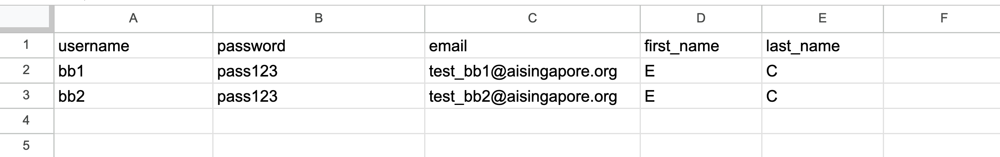

### 2. Enable the Google Sheets API

Programmatic access to Google Sheets is controlled through [Google Cloud Platform](https://cloud.google.com/). Sign in with your AI Singapore account and head over to the [APIs & Services dashboard](https://console.cloud.google.com/apis/dashboard) (select or create a project if asked). As shown below, search for the Sheets API and enable it:

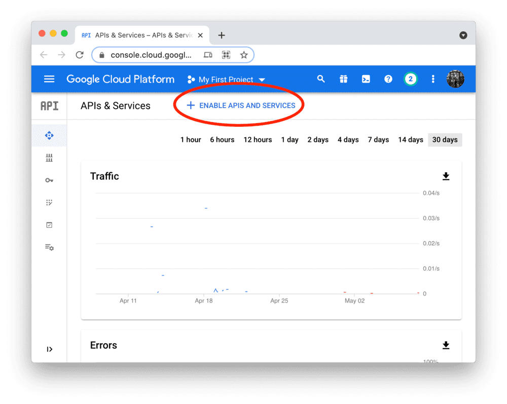
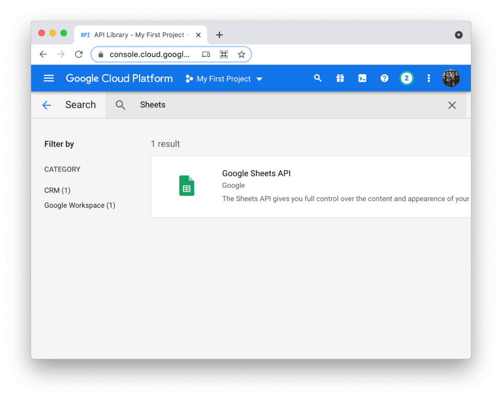
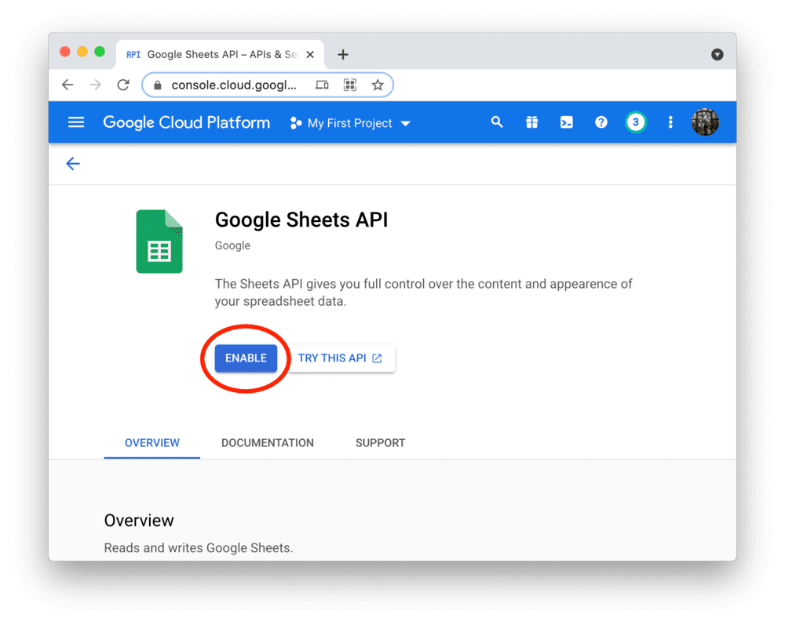

### 3. Create a service account & key file
Go to the Service Accounts page and create an account with the Viewer permission (this will let the account access the google sheet data but not change it):
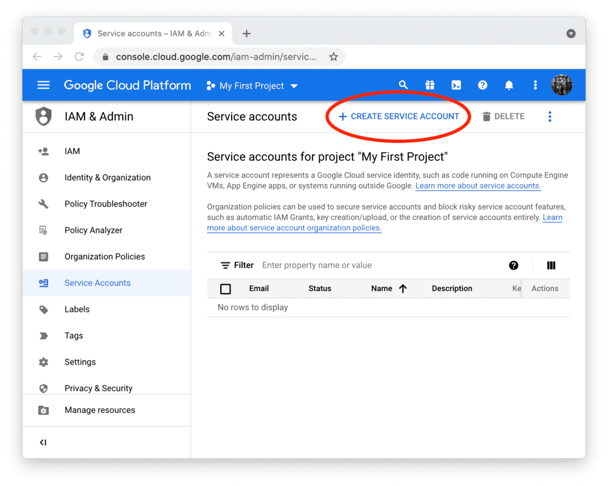
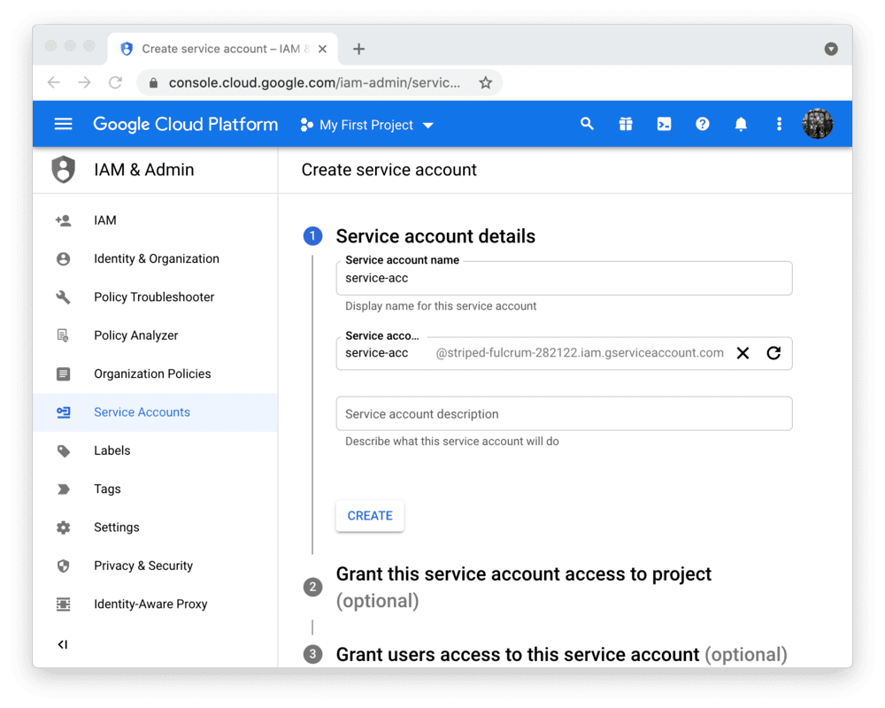
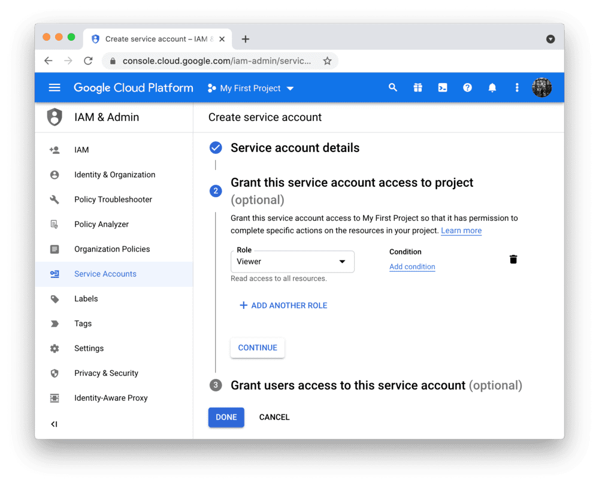

After clicking `DONE`, you should be back on the service accounts overview. First, *note down the email address of the account you just created* (important for next step!). Then, create a JSON key file for the new account and download it:
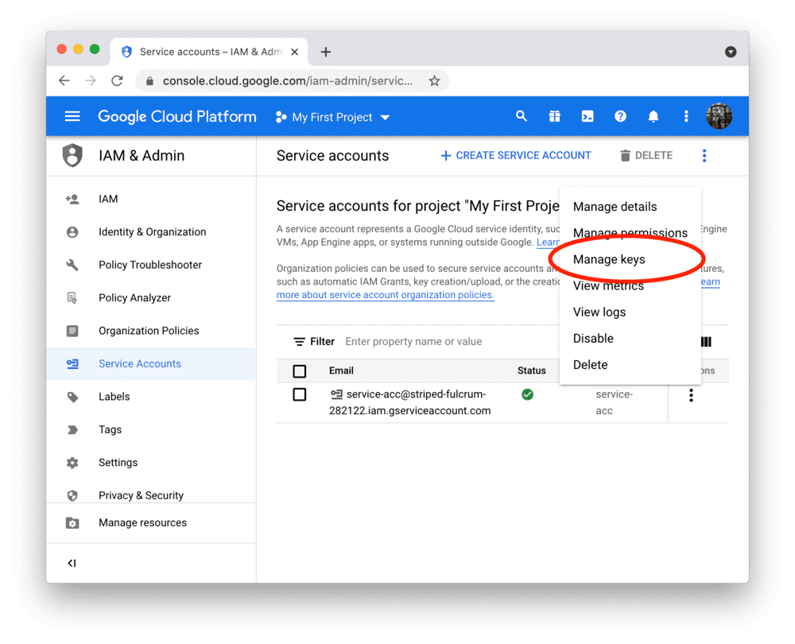
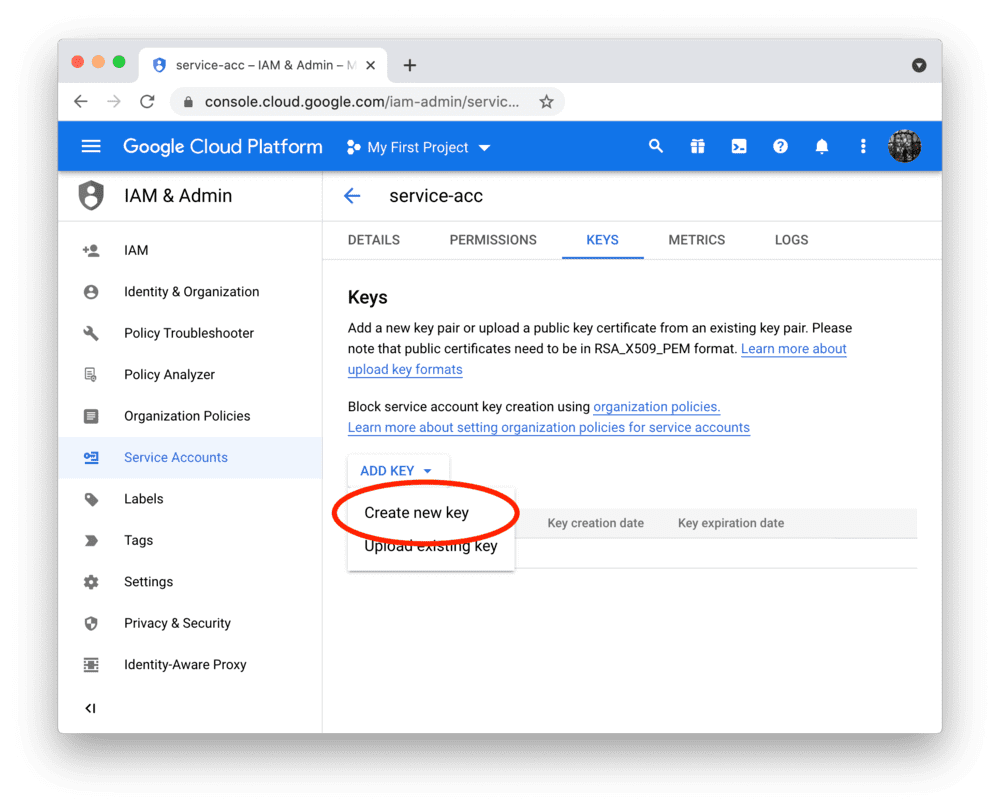
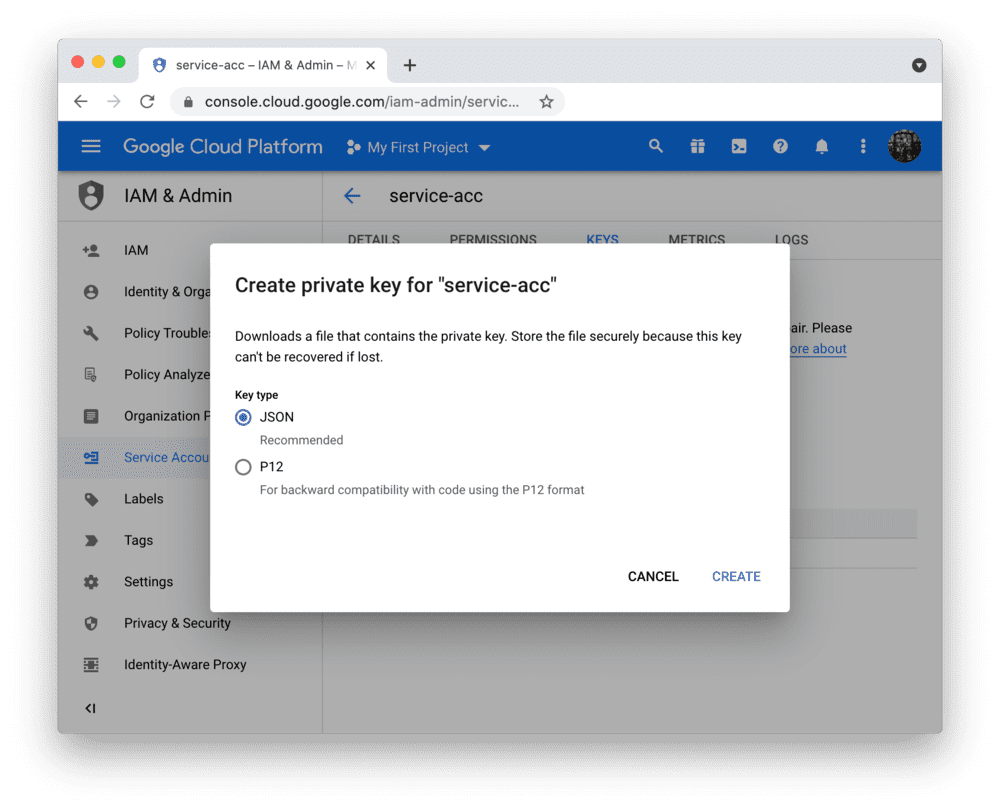

### 4. Share the Google Sheet with the service account
By default, the service account you just created cannot access your Google Sheet (created in Step 1). To give it access, click on the `Share` button in the Google Sheet, add the email of the service account (noted down in step 3), and choose the correct permission (if you just want to read the data, "Viewer" is enough):
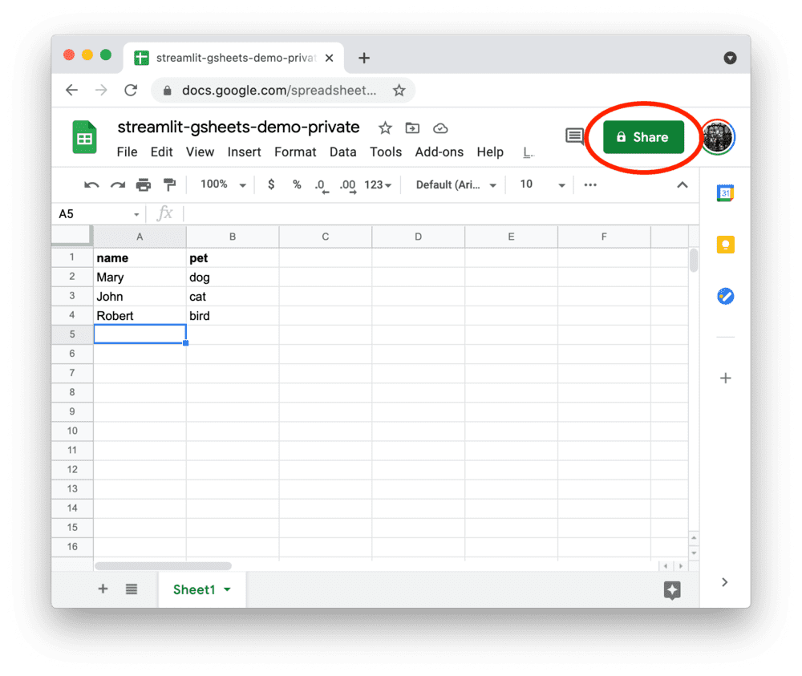
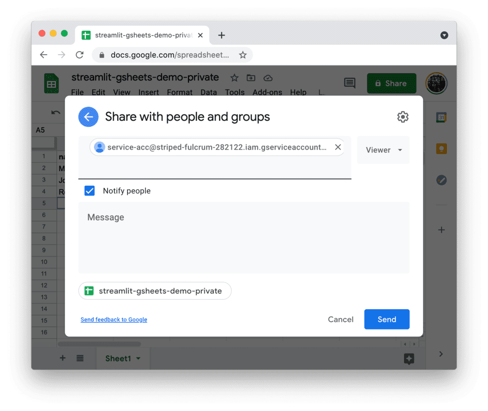

### 5. Add the key file to your local app secrets
The visualisation app will read secrets from a file `.streamlit/secrets.toml` in the app's root directory. Add the URL of your Google Sheet plus the content of the key file you downloaded to from Step 3 as shown below:
```bash
# .streamlit/secrets.toml

[connections.gsheets]
spreadsheet = "https://docs.google.com/spreadsheets/d/xxxxxxx/edit#gid=0"

# From your JSON key file
type = "service_account"
project_id = "xxx"
private_key_id = "xxx"
private_key = "xxx"
client_email = "xxx"
client_id = "xxx"
auth_uri = "https://accounts.google.com/o/oauth2/auth"
token_uri = "https://oauth2.googleapis.com/token"
auth_provider_x509_cert_url = "https://www.googleapis.com/oauth2/v1/certs"
client_x509_cert_url = "xxx"
```

### 6. Enable auth login in the app
By default, the app is configured to disable auth login. Edit the following configuration in `.streamlit/secrets.toml` to enable auth login

```bash
# .streamlit/secrets.toml

[auth]
# option to require auth login or not
require_auth = true

# auth cookie config
cookie_name = "qsviz-cookie"
cookie_key = "qsviz-cookie-key"
cookie_expiry = 30
```

### 7. Re-launch the app
```bash
streamlit run main.py
```
or
```bash
docker compose up --build -d
```